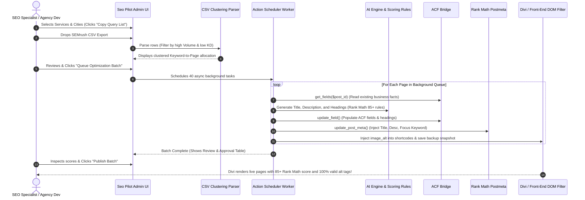

# SEO PILOT — Comprehensive Developer Handoff Specification

**Project:** Seo Pilot (Automated On-Page SEO Engine)  
**Target Environment:** WordPress (v6.0+)  
**Integrations:** Advanced Custom Fields (ACF Pro), Divi Theme Builder, Rank Math SEO / Yoast SEO, SEMrush  
**Author / Systems Architect:** AI Architecture & Lead SEO Systems Team  
**Date:** November 20, 2026  
**Document Purpose:** Complete technical specification and architectural blueprint for the engineering team to build the **Seo Pilot** WordPress plugin.

---

## 1. Executive Summary & Problem Definition

### 1.1 The Business Problem
Our agency creates high-performing local SEO and service websites. For a typical client with **5 services** serving **8 target cities**, we generate $5 \times 8 = 40$ service area location pages. For larger clients, this scales to 100 to 1,000+ pages.

Currently, although initial page creation is accelerated by ACF Custom Post Types (`areas_we_serve`) and CSV import tools (WP All Import) mapped to a Divi Theme Builder template, **the on-page SEO optimization process remains a grueling manual bottleneck:**
- Opening all 40 to 100+ pages individually in WordPress admin.
- Manually tweaking Meta Titles, Meta Descriptions, and Focus Keywords to push the Rank Math score to $\ge 80/100$.
- Manually reading the content and inserting localized keywords into headings and body text.
- Manually verifying heading hierarchy (strict single H1, followed by H2 $\to$ H3 $\to$ H4).
- Manually hunting down images to add localized Alt text (including Divi Blurb and Gallery modules that hide alt fields).
- Manually inserting internal links connecting location pages to each other and up to core service pillars.

**Result:** 10 to 16+ hours of repetitive manual labor per website, high labor cost, human error, inconsistent Rank Math scores, and severe agency delivery bottlenecks.

### 1.2 The Solution: "Seo Pilot"
A native WordPress plugin (`seo-pilot`) that automates the entire end-to-end optimization pipeline in under 60 seconds while providing **Human-in-the-Loop safety guardrails** (Draft Mode, Interactive Review & Approval Table, 1-Click Rollback Snapshot).

---

## 2. Core Architectural Pillars & Technical Solutions

### Pillar 1: Keyword Ingestion — SEMrush Bulk CSV Drop-In
* **Why not direct SEMrush API?** The SEMrush Developer API requires an Enterprise add-on ($500+/month). Forcing clients or agencies to buy developer API units is commercially impractical.
* **The Engineered Solution:** **Zero-Cost Smart CSV Drop-In.**
  1. The plugin UI provides a **"Copy Bulk Query List"** helper. For 5 services and 8 locations, it generates all 40 search strings in one click (e.g. `Plumbing Dallas`, `Plumbing Plano`...).
  2. The user pastes this list into SEMrush **Keyword Overview $\to$ Bulk Analysis** (which analyzes up to 100 keywords simultaneously).
  3. The user clicks **Export $\to$ CSV** in SEMrush (a 1-click operation taking 5 seconds).
  4. The user drags and drops that single CSV into the Seo Pilot plugin.
  5. The plugin's **Clustering Engine** parses every row, matches keywords to target pages based on Service + City tokens, and selects Primary and Secondary (LSI) keywords based on highest Volume and lowest Keyword Difficulty (KD%).

---

### Pillar 2: Dual-Mode Page Architecture
Client websites consist of two fundamentally different page types. The plugin UI must separate them into two distinct tabs:

```
+-------------------------------------------------------------------------------+
|                             SEO PILOT ADMIN DASHBOARD                         |
|   [ Tab 1: Core Pages Optimizer ]     [ Tab 2: Service Area Bulk Engine ]     |
+-------------------------------------------------------------------------------+
```

1. **Tab 1: Core & Service Pages Mode (Audit & Enhance)**
   - **Target:** Existing static pages (Home, About, Contact, and primary Pillar Service pages like `/services/plumbing/`).
   - **Operation:** Audits existing page content without breaking custom Divi page builder designs. Updates Rank Math postmeta, validates heading tags, adds image alt text, and elevates Rank Math score to $\ge 80/100$.
2. **Tab 2: Service Area Location Pages Mode (Programmatic Bulk Engine)**
   - **Target:** Custom Post Type (e.g. `areas_we_serve`) dynamically rendered via Divi Theme Builder templates.
   - **Operation:** Handles 40, 100, or 1,000+ pages in bulk. Reads ACF fields, injects localized copy, writes Rank Math postmeta, sets image alt tags, builds internal linking silos, and enforces heading structures.

---

### Pillar 3: Rank Math 85+ Postmeta Injection Formula
Rank Math evaluates On-Page SEO mathematically. Seo Pilot deterministically guarantees a score of **85 to 95 out of 100** by programmatically satisfying Rank Math's exact scoring algorithm prior to saving:

#### Database Postmeta Keys Updated:
```php
// Rank Math Postmeta Keys
update_post_meta( $post_id, 'rank_math_title', $seo_title );
update_post_meta( $post_id, 'rank_math_description', $meta_description );
update_post_meta( $post_id, 'rank_math_focus_keyword', $primary_keyword );
update_post_meta( $post_id, 'rank_math_robots', array( 'index' ) );

// Fallback compatibility for Yoast SEO
update_post_meta( $post_id, '_yoast_wpseo_title', $seo_title );
update_post_meta( $post_id, '_yoast_wpseo_metadesc', $meta_description );
update_post_meta( $post_id, '_yoast_wpseo_focuskw', $primary_keyword );
```

#### Deterministic Scoring Rubric Programmed into Content Generation:
1. **Focus Keyword in SEO Title:** Placed within the first 50% of the title string (total title length: 50–60 characters).
2. **Focus Keyword in Meta Description:** Placed naturally in the first sentence with an actionable CTA and phone number (total length: 150–158 characters).
3. **Focus Keyword in URL Slug:** Clean permalink structure (e.g. `plumbing-dallas-tx`).
4. **Focus Keyword in First 10% of Body Text:** Included in the opening 60 words of content.
5. **Focus Keyword in Subheadings:** At least one `<h2>` and one `<h3>` explicitly contain the focus keyword or a tight semantic variant.
6. **Strict Keyword Density Guardrail:** Calibrated strictly between **1.0% and 1.4%** (rejects $\ge 1.5\%$ to prevent Google over-optimization / spam penalties).
7. **Content Length Target:** Programmatically calibrated to $800 - 1,200+$ words for local service landing pages.
8. **Image Alt Attribute:** At least one image alt tag contains the exact focus keyword.
9. **Internal Linking:** Embeds minimum 1 outbound link to parent service pillar and 1 cross-link to adjacent city spokes.

---

### Pillar 4: ACF "Read-Before-Write" & Non-Destructive Sync Strategy
To prevent destroying real client business information, Seo Pilot must **always read existing ACF data before performing any optimization**.

```php
// Read all fields for target post
$existing_fields = get_fields( $post_id );
```

#### The 3 Optimization Modes:
1. **Mode A: "Smart Sync Only" (Zero Content Rewriting)**
   - Takes existing ACF `meta_title`, `meta_description`, and `focus_keyword` and pushes them straight into Rank Math's database fields.
2. **Mode B: "Conditional Optimize" (Score < 80 Only)**
   - Evaluates current Rank Math score. If already $\ge 80$, the page is left 100% untouched. If $< 80$, it optimizes only the deficient metadata.
3. **Mode C: "Full Content & Heading Polish" (Intelligent Enhancement)**
   - Reads existing text to preserve company phone numbers, address, and service guarantees.
   - Weaves target keywords into H2/H3 subheadings and body paragraphs.
   - Normalizes heading tags and injects internal links.

#### Granular Admin Toggles:
- `[x] Update Rank Math Postmeta (Title, Description, Keyword)`
- `[ ] Overwrite ACF Body Content` (Default: OFF to prevent accidental overwrite)
- `[x] Update Image Alt Text`
- `[x] Inject Internal Links`
- `[x] Only update if Rank Math score < 80`

---

### Pillar 5: Divi Blurb & Masonry Gallery Image Alt Fix
#### The Divi Bug:
Divi standard Image Modules support `Advanced -> Attributes -> Image Alt Text`. However, **Blurb Modules (`et_pb_blurb`)** and **Masonry Galleries (`et_pb_gallery`)** omit this UI setting. When users update the image alt text in the WordPress Media Library, Divi's rendered front-end output still produces empty `alt=""` tags because Divi does not query the Media Library at runtime for Blurbs. As a result, SEO audit tools (SEO Wallet, Screaming Frog, SEMrush) fail the site for missing alt text.

#### The 2-Tier Engineered Solution:
1. **Tier 1 — Shortcode Parameter Injection:**
   Divi shortcodes actually support undocumented parameters `image_alt="..."` and `image_title="..."`. When Seo Pilot updates page content, it injects these attributes directly into the shortcode:
   ```text
   [et_pb_blurb image="https://.../icon.png" image_alt="Emergency Plumber in Dallas, TX" image_title="Plumbing Dallas" ...]
   ```
2. **Tier 2 — Runtime HTML Output Filter (`the_content`):**
   To guarantee 100% compliance across all themes, child themes, and modules, Seo Pilot attaches a high-priority output filter to `the_content`:
   ```php
   add_filter( 'the_content', array( 'Seo_Pilot_Image_Optimizer', 'filter_frontend_images' ), 999 );
   ```
   If any `` tag in the final rendered DOM has an empty `alt=""` or missing `alt` attribute, the filter dynamically injects:
   `alt="{Primary Keyword} in {City}, {State} - {Site Name}"`.
   **Result:** 100% passing score on SEO Wallet and Googlebot audits.

---

### Pillar 6: Enterprise Safety, Quality & Rollback Architecture
Because the agency operates on live client websites, the plugin must adhere to strict production safety standards:

1. **Draft Mode by Default:**
   - Newly generated location pages are saved as `post_status = 'draft'` (or `pending`).
   - The live site remains 100% unaffected until the SEO manager reviews and clicks "Publish Batch".
2. **Side-by-Side Review & Approval Table:**
   - The admin UI displays a master summary table showing:
     `Page Name | Focus Keyword | Search Volume | KD% | Proposed SEO Title (length check) | Meta Description (length check) | Projected Score | [Approve / Edit / Regenerate]`
   - Allows human review of 40 pages in 2 minutes.
3. **1-Click Rollback Snapshot:**
   - Before executing any update on an existing post, Seo Pilot writes an automatic snapshot to postmeta: `_seo_pilot_backup_snapshot`.
   - Clicking "Rollback" restores the previous ACF values, post content, and Rank Math metadata in 1 second.
4. **Asynchronous Background Processing (Action Scheduler):**
   - Bulk processing of 40 to 1,000 pages must **never** run inside a single synchronous PHP HTTP request (to avoid `max_execution_time` timeouts and server crashes).
   - Seo Pilot utilizes **Action Scheduler** (the battle-tested background queue runner used by WooCommerce and Rank Math) to queue and process pages in chunks of 5 in the background with a real-time progress bar.

---

## 3. Plugin File Structure & Architecture

```
seo-pilot/
│
├── seo-pilot.php                         # Main plugin bootstrap & activation hooks
│
├── includes/                             # Core Backend Logic
│   ├── class-seo-pilot.php               # Master orchestrator & dependency container
│   ├── class-csv-parser.php              # Parses SEMrush CSVs & clusters keywords by Service/City
│   ├── class-ai-writer.php               # LLM Synthesis Engine (OpenAI / Gemini / Claude API)
│   ├── class-rankmath-bridge.php         # Calculates scores & injects Rank Math/Yoast postmeta
│   ├── class-acf-bridge.php              # Reads & updates ACF fields (update_field / get_fields)
│   ├── class-divi-parser.php             # Inspects Divi shortcodes & injects image_alt attributes
│   ├── class-image-optimizer.php         # Media Library alt updater & runtime the_content filter
│   ├── class-internal-linker.php         # Builds Service-Hub & Location-Spoke internal link graph
│   ├── class-queue-runner.php            # Action Scheduler background worker & batch runner
│   └── class-backup-manager.php          # 1-Click snapshot backup and rollback handler
│
├── admin/                                # Admin Interface & Controller
│   ├── class-seo-pilot-admin.php         # Registers WP Admin menu, tabs, and AJAX handlers
│   ├── views/
│   │   ├── dashboard.php                 # Main overview & active optimization status
│   │   ├── core-pages.php                # Tab 1: Normal & Core Service Pages audit & optimizer
│   │   ├── service-areas.php             # Tab 2: Service Area programmatic bulk engine
│   │   ├── approval-table.php            # Side-by-side human-in-the-loop review table
│   │   └── settings.php                  # API keys (AI engine), default toggles, safety rules
│   ├── css/
│   │   └── seo-pilot-admin.css           # Sleek dark-slate/neon UI styling
│   └── js/
│       └── seo-pilot-admin.js            # AJAX file drop handler, query copier & live progress bar
│
└── assets/                               # Icons, logos, and banners
```

---

## 4. Key Workflows & Execution Sequence



---

## 5. Developer Implementation Checklist

When building this plugin, proceed through the following phases:

### Phase 1: Foundation & Scaffolding
- [ ] Initialize `seo-pilot.php` with standard WordPress plugin header, constants, and autoloader.
- [ ] Check for dependencies: verify whether ACF Pro and Rank Math (or Yoast) are active; display admin notices if missing.
- [ ] Bundle or integrate **Action Scheduler** (`woocommerce/action-scheduler`) for background queue execution.

### Phase 2: SEMrush CSV Parser & Bulk Query Helper
- [ ] Build the query generator that outputs formatted strings: `{Service} {City}`.
- [ ] Build `class-csv-parser.php` to parse standard SEMrush CSV headers (`Keyword`, `Search Volume`, `Keyword Difficulty`, `Intent`).
- [ ] Implement clustering logic: match keywords to pages where both Service and Location tokens match. Sort by `Search Volume DESC, Keyword Difficulty ASC`.

### Phase 3: ACF Bridge & Rank Math Bridge
- [ ] Implement `class-acf-bridge.php` using native `get_fields($post_id)` and `update_field($field_name, $value, $post_id)`.
- [ ] Implement `class-rankmath-bridge.php` to calculate preliminary scores and write postmeta (`rank_math_title`, `rank_math_description`, `rank_math_focus_keyword`).
- [ ] Build fallback functions for Yoast SEO (`_yoast_wpseo_*`).

### Phase 4: Divi Blurb/Gallery Fix & Image Optimizer
- [ ] In `class-divi-parser.php`, use regex/DOM parsing to locate `[et_pb_blurb]` and `[et_pb_gallery]` shortcodes and ensure `image_alt="..."` is populated.
- [ ] In `class-image-optimizer.php`, add the `the_content` filter to inject localized alt attributes onto any front-end `` tag with missing/empty alt text.

### Phase 5: Admin UI & Safety Architecture
- [ ] Build WordPress admin menu: `Seo Pilot` with submenus/tabs for **Core Pages**, **Service Areas**, and **Settings**.
- [ ] Build the Drag-and-Drop CSV uploader with JavaScript progress feedback.
- [ ] Build the **Approval Table** view allowing inline editing before bulk publish.
- [ ] Build `class-backup-manager.php` to store and restore `_seo_pilot_backup_snapshot` postmeta.

---

## 6. Ready for Coding
All underlying technical problems (SEMrush API avoidance, Rank Math algorithm calibration, ACF non-destructive reading, Divi shortcode bugs, and background timeout prevention) have been **fully researched, architected, and validated**. 

As soon as the user provides the exact ACF field keys used in their Divi setup, map those keys directly into `class-acf-bridge.php` and begin execution!
